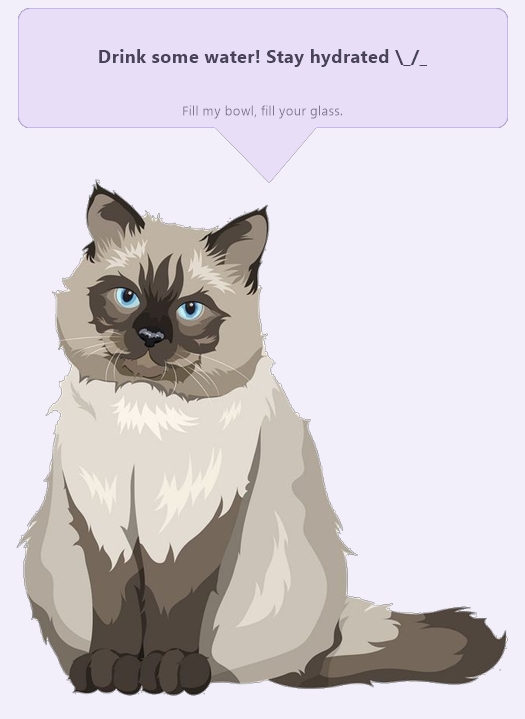
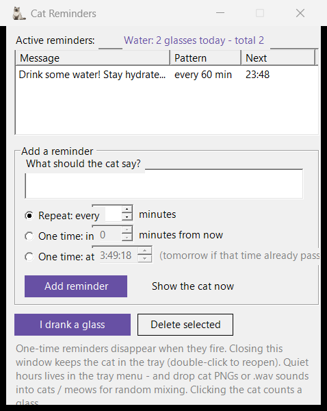

# cat-water-reminder

A cat lives in your system tray and pops up now and then to tell you to drink water. Made because I kept forgetting and alarms are annoying.

One PowerShell script, no installer, no dependencies. Runs on any Windows 10/11.

- Cat says things every N minutes, or once at a set time (then leaves)
- Click the cat to shoo it away (and log a glass of water). Hover it and it gives you 10 seconds before leaving on its own
- Right-click = snooze 10 min, double-click = quiet for an hour
- Quiet hours so the cat naps at night, and it stays polite during fullscreen games and presentations
- A little water tally: today's glasses and all-time

The looks are customizable: drop in any image as `cat.png` (it auto-crops and strips the background, even if you screenshot it off some website) and any sound as `meow.wav`. Want a whole litter? Drop extra PNGs into a `cats` folder next to the script — every popup picks a random cat, a random line and a random meow (from a `meows` folder), so no two popups look the same. The popup lines live in a list at the top of the script.

Panel looks like this, if you're into settings:

Launch `launch-cat.vbs`, forget about it. Reminders survive reboots, the app idles at ~13 MB, and it starts itself 45 seconds after login so it doesn't slow your boot.

The comfy way: run `install.bat` — it copies the folder to `%LOCALAPPDATA%\CatReminders`, wires the Start Menu and logon shortcuts, and starts the cat. `uninstall.bat` removes everything, no drama.

MIT. Meow is CC0 from Wikimedia.
