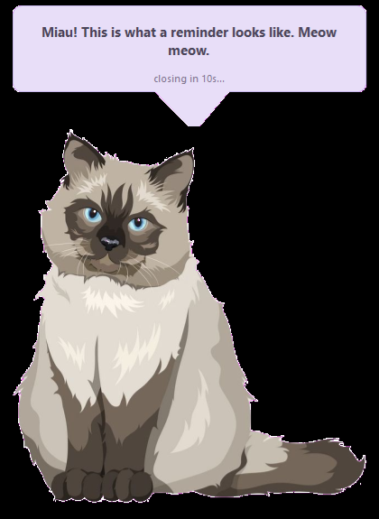
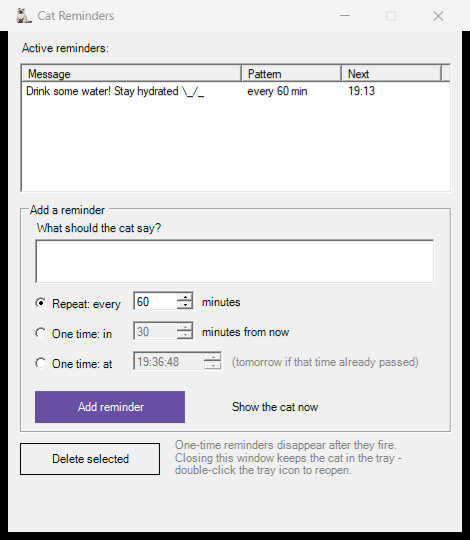

# cat-water-reminder

A cat lives in your system tray and pops up now and then to tell you to drink water. Made because I kept forgetting and alarms are annoying.

Windows is one PowerShell script with no installer and no extra dependencies. Linux is a Python 3 / GTK 3 port with an optional shell installer; both read and write the same `reminders.json` / `settings.json`, so you can share your reminders and water tally between them.



- Cat says things every N minutes, or once at a set time (then leaves)
- Click the cat to shoo it away (and log a glass of water). Hover it and it gives you 10 seconds before leaving on its own
- Right-click = snooze 10 min, double-click = quiet for an hour
- Quiet hours so the cat naps at night, and it stays polite during fullscreen games and presentations
- A little water tally: today's glasses and all-time

## Quick install

Get the files first (or download the ZIP from GitHub):

```bash
git clone https://github.com/vishn0o/cat-water-reminder.git
cd cat-water-reminder
```

**Windows** — double-click `install.bat` (or run it from a terminal). It copies the app to `%LOCALAPPDATA%\CatReminders`, creates Start Menu and logon shortcuts, and starts the cat. `uninstall.bat` removes it. To try it without installing, just run `launch-cat.vbs`.

**Linux** — from a checkout of this repo:

```bash
bash install.sh          # installs to ~/.local/share/cat-reminders + autostart
bash uninstall.sh        # removes it
```

Or run it in place: `chmod +x cat-reminders-launcher.sh && ./cat-reminders-launcher.sh`. Dependencies and desktop notes are in the Linux section below.

On Windows the looks are customizable: drop in any image as `cat.png` (it auto-crops and strips the background, even if you screenshot it off some website) and any sound as `meow.wav`. Want a whole litter? Drop extra PNGs into a `cats` folder next to the script — every popup picks a random cat, a random line and a random meow (from a `meows` folder), so no two popups look the same. The Linux build deliberately uses only the bundled `cat_cut.png` and `meow.wav`; cat/meow folders are ignored. The popup lines live in a list at the top of the script.

Panel looks like this, if you're into settings:



Launch `launch-cat.vbs`, forget about it. Reminders survive reboots, the app idles at ~13 MB, and it starts itself 45 seconds after login so it doesn't slow your boot.

The comfy way: run `install.bat` — it copies the folder to `%LOCALAPPDATA%\CatReminders`, wires the Start Menu and logon shortcuts, and starts the cat. `uninstall.bat` removes everything, no drama.

## Linux (Linux Mint / Ubuntu)

The port is `cat-reminders.py` (GTK 3). Mint ships almost everything it needs; the
installer checks and tells you what is missing:

```
sudo apt install python3-gi python3-cairo gir1.2-gtk-3.0 \
                 gir1.2-pango-1.0 gir1.2-gdkpixbuf-2.0 gir1.2-xapp-1.0
```

Run it from the folder:

```
chmod +x cat-reminders-launcher.sh
./cat-reminders-launcher.sh
```

Or install it:

```
bash install.sh
```

That copies the app to `~/.local/share/cat-reminders`, adds a Start Menu entry and a logon autostart (45 second delay), and starts the cat. `bash uninstall.sh` removes everything.

`reminders.json` and `settings.json` live next to `cat-reminders.py` (after installing, that is `~/.local/share/cat-reminders`). The Linux build uses the bundled `cat_cut.png` and `meow.wav`; `cats/` and `meows/` folders are ignored. The JSON format is identical to the Windows version, so you can copy those two files between the installs to keep your reminders and water tally.

The tray cat uses XApp on Cinnamon (with appindicator / legacy tray fallbacks elsewhere), so its menu opens on a normal click. Everything else works like the Windows version: click the cat to shoo it and log a glass, right-click to snooze 10 minutes, double-click to go quiet for an hour, quiet hours and fullscreen deferral via the tray menu.

It is not Mint-only: it runs on any X11 desktop with GTK 3 (GNOME, KDE Plasma, XFCE, MATE, etc.). Package names differ outside apt — the installer prints hints for dnf and pacman too. GNOME needs a tray extension (for example Ubuntu AppIndicators) for the icon to show. Wayland sessions are not supported: the click-through popup and the `xprop` fullscreen check need X11.

The panel is created only when you open it, and a popup frees its buffers as soon as it closes, so idle memory stays as low as GTK 3 allows. To check the real shared-library footprint on your machine:

```bash
sudo apt install smem          # optional, Debian/Ubuntu
smem -P cat-reminders          # look at the PSS column
```

If the cat misbehaves, `~/.local/share/cat-reminders/debug.log` records reminders, tray setup, image loading and shutdown.

For a full manual validation checklist see [docs/TESTING.md](docs/TESTING.md), and run `bash verify-linux.sh` to check the environment. The GTK-free logic tests run anywhere with `python3 tests/run_all.py`. Release notes live in [CHANGELOG.md](CHANGELOG.md).

MIT. Meow is CC0 from Wikimedia.
